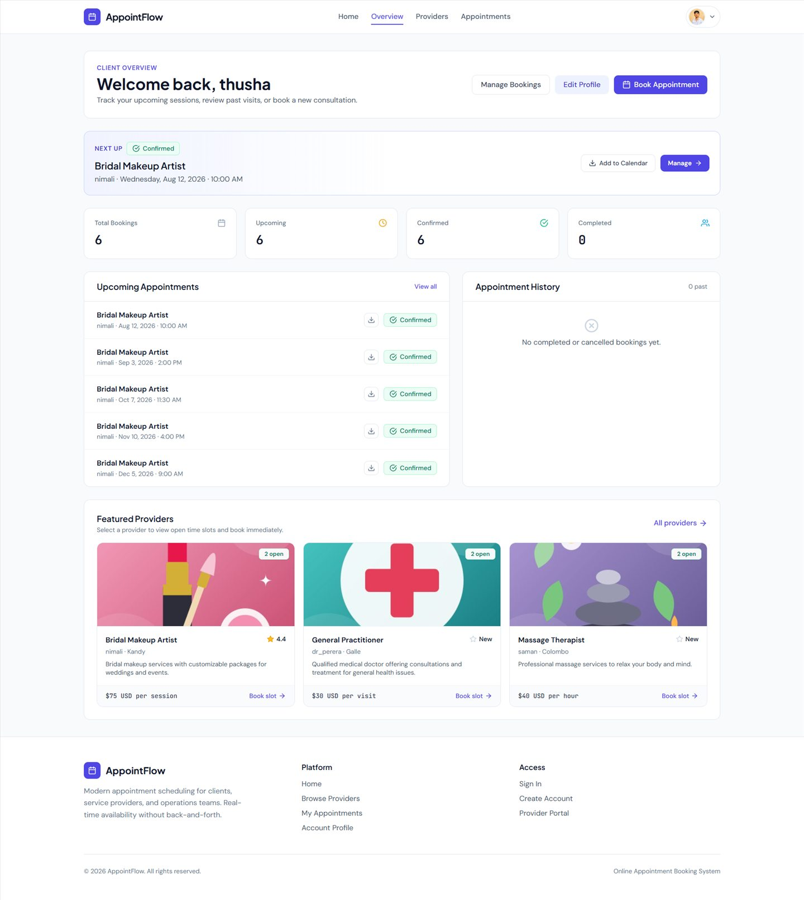
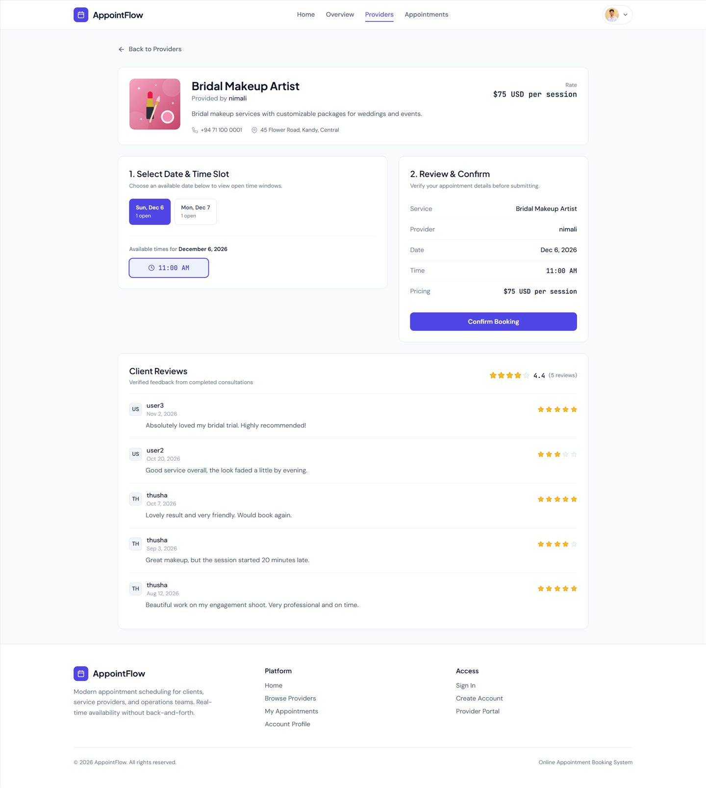
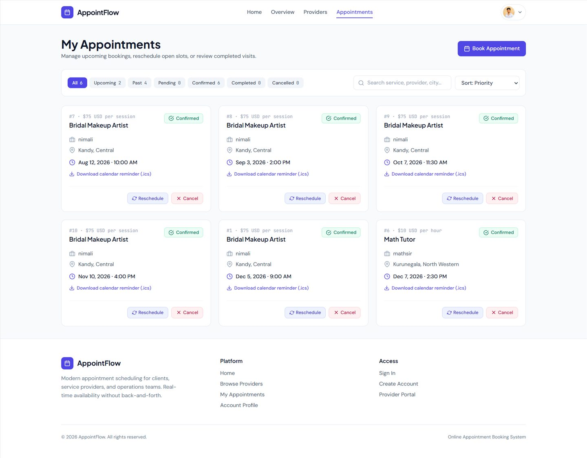

# AppointFlow - Online Appointment Booking System


AppointFlow is a full-stack appointment booking application. Clients can find service providers, check availability, book appointments, and manage their bookings. Providers manage their profiles and schedules, while administrators manage users, providers, and appointments.

## Features

### Clients

- Register and sign in with JWT-based authentication.
- Search providers by service, city, or both; review provider profiles, pricing, availability, and client reviews.
- Book an available time slot, view appointment status, reschedule or cancel bookings, and download calendar reminders.
- Update profile information and leave or edit a review after a completed appointment.

### Service providers

- Register with a provider account and set up a service profile.
- Create and manage available time slots.
- Review appointments and update their status from the provider dashboard.

### Administrators

- View platform statistics and manage users, service-provider listings, and appointments.

Provider approval workflows are not currently implemented. Providers create their service profile from the provider setup flow.

## Screenshots

| Home page | System overview |
| --- | --- |
|  |  |

| Provider directory | Appointment booking |
| --- | --- |
|  |  |



## Technology

- **Frontend:** React 19, React Router, Redux Toolkit, Axios, Tailwind CSS, Vite 7
- **Backend:** Java 24, Spring Boot 3.5.4, Spring Security, Spring Data JPA, Maven
- **Database:** MySQL
- **Authentication:** JWT

## Requirements

- Node.js supported by Vite 7 (20.19+ or 22.12+ recommended) and npm
- Java 24
- MySQL

## Setup

### 1. Clone the repository

```bash
git clone https://github.com/Thushakaran/online_appointment_booking_system.git
cd online_appointment_booking_system
```

### 2. Create the database

Start MySQL and create the application database:

```sql
CREATE DATABASE online_appointment_booking_system;
```

The backend reads its database credentials and JWT signing key from environment variables. Do not commit real credentials or signing keys. Generate a unique Base64 JWT key containing at least 32 random bytes for each environment, for example with `openssl rand -base64 32`. Rotate any credentials or signing keys that were previously committed.

PowerShell:

```powershell
$env:DB_USERNAME = "root"
$env:DB_PASSWORD = "your-mysql-password"
$env:JWT_SECRET = "paste-generated-base64-key-here"
```

macOS/Linux:

```bash
export DB_USERNAME="root"
export DB_PASSWORD="your-mysql-password"
export JWT_SECRET="paste-generated-base64-key-here"
```

Set these variables in the terminal session used to start the backend. The backend uses automatic schema updates and a schema initialization script for local development.

### 3. Start the backend

From the repository root, run:

```powershell
cd backend
.\mvnw.cmd spring-boot:run
```

On macOS/Linux:

```bash
cd backend
./mvnw spring-boot:run
```

The API listens on `http://localhost:8081`.

### 4. Start the frontend

In a second terminal, from the repository root:

```bash
npm install
npm run dev
```

The Vite development server listens on `http://localhost:3000` and proxies `/api` requests to the backend at port 8081. Set `BACKEND_URL` before starting Vite to use a different backend address.

## Admin account

Public registration cannot create administrator accounts. Follow the [Admin Setup Guide](backend/ADMIN_SETUP.md) to create an initial admin account.

## Useful commands

Run these from the repository root:

```bash
npm run lint
npm run build
```

Run backend tests from `backend`. The configured test starts the Spring application, so MySQL and the required environment variables must be available.

Windows PowerShell:

```powershell
.\mvnw.cmd test
```

macOS/Linux:

```bash
./mvnw test
```

## Project layout

```text
backend/       Spring Boot API, database entities, and business logic
frontend/      React application and Vite configuration
docs/          Product screenshots
public/        README screenshot and other public assets
README.md      Project setup and usage guide
```

## Development notes

The current database settings use automatic schema updates and SQL logging for development. Review these settings, configure production secrets, restrict CORS origins, and use managed database migrations before deploying to production.
