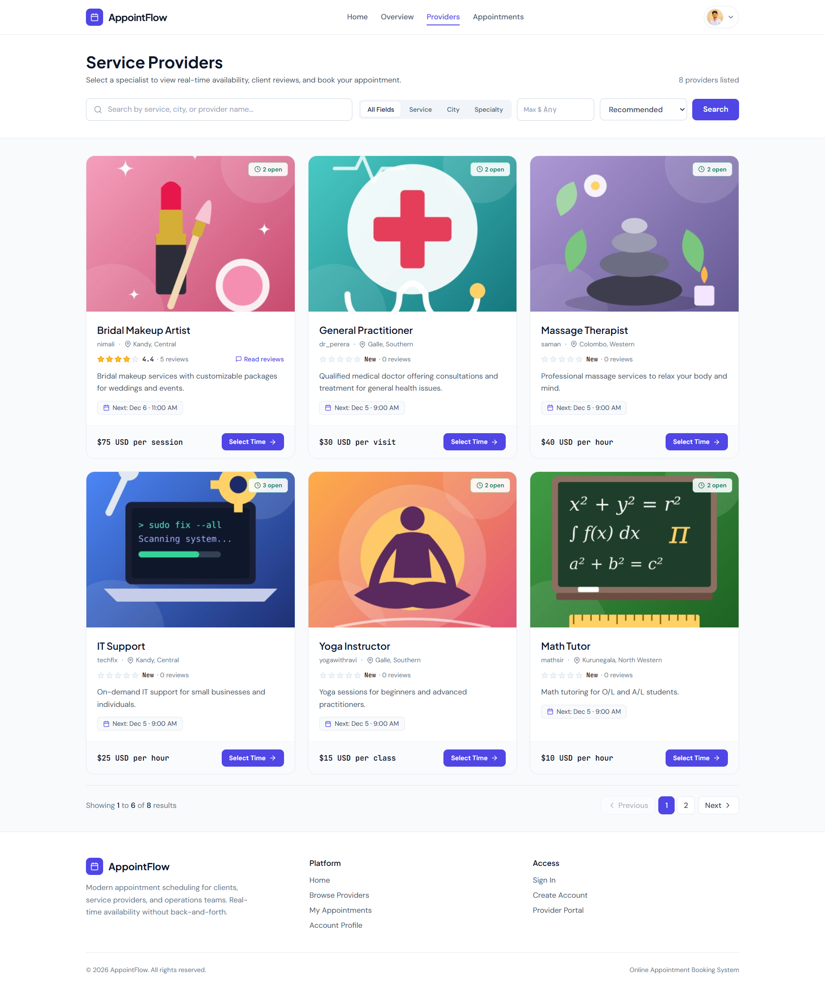
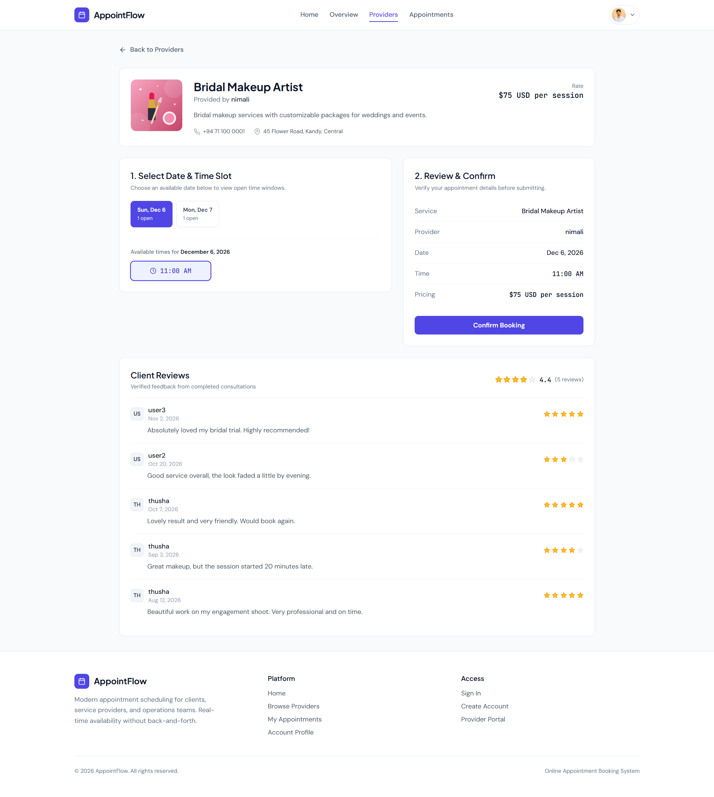

# Online Application Booking System

A full-stack web application for managing appointment bookings between users and service providers. Built with React frontend and Spring Boot backend.

## Screenshots

### Home


### System Overview


### Service Providers



### Appointment Booking



### Appointments


## 🚀 Features

### For Users

- **User Registration & Authentication**: Secure JWT-based authentication system
- **Browse Service Providers**: View available service providers and their details
- **Book Appointments**: Schedule appointments with preferred providers
- **Manage Appointments**: View, reschedule, or cancel existing appointments
- **User Profile**: Update personal information and view booking history

### For Service Providers

- **Provider Registration**: Set up service provider accounts
- **Availability Management**: Set and manage available time slots
- **Appointment Management**: View and manage incoming appointment requests
- **Provider Dashboard**: Monitor bookings and availability

### For Administrators

- **User Management**: Manage all users and service providers
- **System Overview**: View system statistics and analytics
- **Provider Approval**: Approve or reject service provider registrations
- **Admin Dashboard**: Comprehensive administrative interface

## 🛠️ Tech Stack

### Frontend

- **React 19** - Modern React with hooks and functional components
- **Redux Toolkit** - State management
- **React Router** - Client-side routing
- **Axios** - HTTP client for API communication
- **Tailwind CSS** - Utility-first CSS framework
- **React Icons** - Icon library
- **Day.js** - Date manipulation library
- **Vite** - Build tool and development server

### Backend

- **Spring Boot 3.5.4** - Java-based web framework
- **Spring Security** - Authentication and authorization
- **Spring Data JPA** - Database access layer
- **MySQL** - Relational database
- **JWT** - JSON Web Tokens for authentication
- **Lombok** - Reduces boilerplate code
- **Maven** - Build tool and dependency management

## 🚀 Quick Start

### 1. Clone the Repository

```bash
git clone https://github.com/Thushakaran/online_appointment_booking_system.git
cd online_appointment_booking_system
```

### 2. Database Setup

1. Create a MySQL database:

```sql
CREATE DATABASE online_appointment_booking_system;
```

2. Update database credentials in `backend/src/main/resources/application.properties`:

```properties
spring.datasource.username=your_username
spring.datasource.password=your_password
```

### 3. Backend Setup

1. Navigate to the backend directory:

```bash
cd backend
```

2. Run the Spring Boot application:

```bash
./mvnw spring-boot:run
```

The backend will start on `http://localhost:8081`

### 4. Frontend Setup

1. Navigate to the frontend directory:

```bash
cd frontend
```

2. Install dependencies:

```bash
npm install
```

3. Start the development server:

```bash
npm run dev
```

The frontend will start on `http://localhost:5173`

## 👤 Admin Setup

For security reasons, admin users cannot be created through the public registration. Follow the [Admin Setup Guide](backend/ADMIN_SETUP.md) to create your first admin account.

### Quick Admin Setup (Development)

1. Start the application
2. Connect to your MySQL database
3. Insert the first admin user:

```sql
INSERT INTO user (username, email, password, role)
VALUES (
    'admin',
    'admin@example.com',
    '$2a$10$YourHashedPasswordHere',
    'ADMIN'
);
```

## 📁 Project Structure

```
Online-Application-Booking-System/
├── backend/                          # Spring Boot backend
│   ├── src/main/java/
│   │   └── com/se/Online/Appointment/Booking/System/
│   │       ├── config/               # Configuration classes
│   │       ├── controller/           # REST controllers
│   │       ├── dto/                  # Data Transfer Objects
│   │       ├── model/                # Entity models
│   │       ├── repository/           # Data access layer
│   │       ├── security/             # Security configuration
│   │       └── service/              # Business logic
│   ├── src/main/resources/
│   │   └── application.properties    # Application configuration
│   └── pom.xml                       # Maven dependencies
├── docs/screenshots/                 # Application screenshots
├── frontend/                         # React frontend
│   ├── src/
│   │   ├── api/                      # API integration
│   │   ├── app/                      # Redux store
│   │   ├── components/               # Reusable components
│   │   ├── features/                 # Feature-specific code
│   │   └── pages/                    # Page components
│   ├── package.json                  # Node.js dependencies
│   └── vite.config.js               # Vite configuration
└── README.md                         # This file
```

**Note**: This is a development version. For production deployment, ensure proper security configurations, environment variables, and database optimizations are in place.
